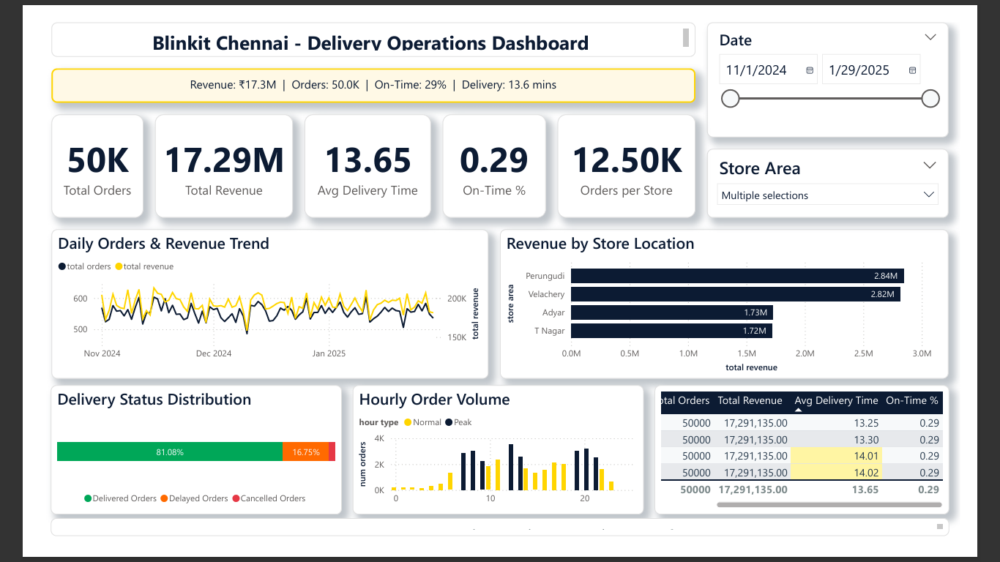

# Blinkit Chennai - Quick Commerce Delivery Optimization

**Portfolio analytics project analyzing a synthetic 50,000-order Chennai quick-commerce dataset to demonstrate operational analysis, SQL modeling, and dashboarding.**

> **Data honesty:** the dataset is synthetically generated for portfolio demonstration. The findings below are illustrative and must not be interpreted as actual Blinkit operating metrics or forecasts.

---

## Project Overview

Analyzed delivery performance across 12 illustrative dark stores in Chennai to demonstrate a business-analytics workflow: data generation → MySQL modeling → SQL analysis → Power BI reporting → operational recommendations.

**Tech Stack:** Python | MySQL | SQL | Power BI | DAX

## Key Findings from the Synthetic Dataset

- **45% orders meet the illustrative 10-minute SLA** (target used in the exercise: 70%+)
- **T Nagar & Velachery show 18+ minute average delivery times** in the synthetic data
- **Peak hours (7-9 PM) show materially higher delivery times** than the morning period
- **245 high-demand products are flagged as out of stock** in the synthetic inventory model
- **₹4.8L is represented as illustrative overstock value** in the synthetic dataset

These are scenario-analysis outputs, not real Blinkit performance figures.

## Business Recommendations

Recommendations are framed as analytical hypotheses to test rather than guaranteed business outcomes:

1. Evaluate additional capacity in high-delay areas and validate the effect with a location/network model.
2. Test predictive inventory policies for categories with repeated stockout signals.
3. Model staffing and courier capacity for the 7-9 PM peak period.
4. Reallocate or liquidate selected overstock only after validating margin, shelf-life and demand assumptions.

## Technical Implementation

### Data Generation (Python)
- Synthetic dataset: 50,000 orders, 12 stores, 290 products
- Controlled patterns for peak hours, demand levels and delivery times
- Libraries: pandas, numpy, datetime

### Database Design (MySQL)
- Star-style analytical schema
- SQL views for repeatable reporting
- Indexes and foreign-key relationships where appropriate

### SQL Analysis
- Delivery performance metrics
- Inventory health analysis
- Revenue trends by store/category
- Peak-hour demand patterns

### Power BI Dashboard
- Executive reporting layout
- DAX measures
- Store/date filtering and cross-filtering

## Dashboard Preview



## Project Structure

```text
blinkit-chennai-delivery-analysis/
├── data/
├── sql/
│   └── blinkit_chennai.zip
├── powerbi/
├── screenshots/
└── README.md
```

> **Setup note:** the committed SQL artifact is currently `sql/blinkit_chennai.zip`, not `sql/blinkit_chennai.sql`. Extract the archive first or replace it with the plain `.sql` source file before using the command-line setup below.

## How to Run

### Prerequisites
- MySQL 8.0+
- Power BI Desktop
- Python 3.8+ (optional, for data generation)

### Setup
1. Extract `sql/blinkit_chennai.zip` if you need the SQL source.
2. Import the extracted SQL script into MySQL.
3. Open the Power BI file under `powerbi/` and refresh its data connection if required.
4. Explore the dashboard using the available filters.

## Key Learnings

**SQL:** joins, aggregations, CTEs, window functions and business views.

**Power BI:** DAX measures, analytical modeling, conditional formatting and cross-filtering.

**Business Analysis:** translating operational signals into testable recommendations while separating observed results from assumptions.

## License

MIT License - see the repository license file for details.
